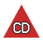

<!-- Generated by tools/symbols/Generate.cs from src/AprsNet.Symbols. Do not edit: the symbols workflow regenerates this page. -->

# Modern APRS symbols

Every APRS symbol as drawn by the `AprsNet.Symbols` library in the modern style:
`AprsSymbolImages.GetSvg(symbol, AprsSymbolStyle.Modern)`. See also the [conventional style](conventional.md).

Each symbol is a white glyph on a disc coloured by its category. Overlay families keep their shape (star, diamond, circle, box, triangle) as the coloured container.
Images are SVG on a 48×48 grid, shown here at 24 and 48 px. 165 symbols are drawn: every assigned
symbol and every legacy one older stations still send. Meanings come from APRS101 Appendix 2 and the APRS 1.1
and 1.2 symbol lists.

- [Primary table](#primary-table)
- [Alternate table](#alternate-table)
- [Overlays](#overlays)
- [Unassigned and reserved codes](#unassigned-and-reserved-codes)

## Primary table

| Symbol | 24 px | 48 px | Name | Category | Destination code |
| --- | :-: | :-: | --- | --- | --- |
| <code>/!</code> |  |  | Police or sheriff | Emergency | <code>BB</code> |
| <code>/#</code> |  |  | Digipeater (white centre) | Radio | <code>BD</code> |
| <code>/$</code> |  |  | Phone | Radio | <code>BE</code> |
| <code>/%</code> |  |  | DX cluster | Radio | <code>BF</code> |
| <code>/&amp;</code> |  |  | HF gateway | Radio | <code>BG</code> |
| <code>/&#39;</code> |  |  | Small aircraft | Aircraft | <code>BH</code> |
| <code>/(</code> |  |  | Mobile satellite station | Radio | <code>BI</code> |
| <code>/)</code> |  |  | Wheelchair (handicapped) | Places | <code>BJ</code> |
| <code>/*</code> |  |  | Snowmobile | Vehicles | <code>BK</code> |
| <code>/+</code> |  |  | Red Cross | Emergency | <code>BL</code> |
| <code>/,</code> |  |  | Boy Scouts | Places | <code>BM</code> |
| <code>/-</code> |  |  | House (VHF) | Places | <code>BN</code> |
| <code>/.</code> |  |  | X | Markers | <code>BO</code> |
| <code>//</code> |  |  | Red dot | Markers | <code>BP</code> |
| <code>/0</code> |  |  | Numbered circle 0 (obsolete) *(legacy)* | Markers | <code>P0</code> |
| <code>/1</code> |  |  | Numbered circle 1 (obsolete) *(legacy)* | Markers | <code>P1</code> |
| <code>/2</code> |  |  | Numbered circle 2 (obsolete) *(legacy)* | Markers | <code>P2</code> |
| <code>/3</code> |  |  | Numbered circle 3 (obsolete) *(legacy)* | Markers | <code>P3</code> |
| <code>/4</code> |  |  | Numbered circle 4 (obsolete) *(legacy)* | Markers | <code>P4</code> |
| <code>/5</code> |  |  | Numbered circle 5 (obsolete) *(legacy)* | Markers | <code>P5</code> |
| <code>/6</code> |  |  | Numbered circle 6 (obsolete) *(legacy)* | Markers | <code>P6</code> |
| <code>/7</code> |  |  | Numbered circle 7 (obsolete) *(legacy)* | Markers | <code>P7</code> |
| <code>/8</code> |  |  | Numbered circle 8 (obsolete) *(legacy)* | Markers | <code>P8</code> |
| <code>/9</code> |  |  | Numbered circle 9 (obsolete) *(legacy)* | Markers | <code>P9</code> |
| <code>/:</code> |  |  | Fire | Emergency | <code>MR</code> |
| <code>/;</code> |  |  | Campground (portable operation) | Places | <code>MS</code> |
| <code>/&lt;</code> |  |  | Motorcycle | Vehicles | <code>MT</code> |
| <code>/=</code> |  |  | Railroad engine | Vehicles | <code>MU</code> |
| <code>/&gt;</code> |  |  | Car | Vehicles | <code>MV</code> |
| <code>/?</code> |  |  | File server | Radio | <code>MW</code> |
| <code>/@</code> |  |  | Hurricane future prediction (dot) | Weather | <code>MX</code> |
| <code>/A</code> |  |  | Aid station | Emergency | <code>PA</code> |
| <code>/B</code> |  |  | BBS or PBBS | Radio | <code>PB</code> |
| <code>/C</code> |  |  | Canoe | Marine | <code>PC</code> |
| <code>/E</code> |  |  | Eyeball (events) | Places | <code>PE</code> |
| <code>/F</code> |  |  | Farm vehicle (tractor) | Vehicles | <code>PF</code> |
| <code>/G</code> |  |  | Grid square (6 characters) | Markers | <code>PG</code> |
| <code>/H</code> |  |  | Hotel (blue bed) | Places | <code>PH</code> |
| <code>/I</code> |  |  | TCP/IP on-air network station | Radio | <code>PI</code> |
| <code>/K</code> |  |  | School | Places | <code>PK</code> |
| <code>/L</code> |  |  | PC user | Radio | <code>PL</code> |
| <code>/M</code> |  |  | MacAPRS | Radio | <code>PM</code> |
| <code>/N</code> |  |  | NTS station | Radio | <code>PN</code> |
| <code>/O</code> |  |  | Balloon | Aircraft | <code>PO</code> |
| <code>/P</code> |  |  | Police | Emergency | <code>PP</code> |
| <code>/R</code> |  |  | Recreational vehicle | Vehicles | <code>PR</code> |
| <code>/S</code> |  |  | Space shuttle | Aircraft | <code>PS</code> |
| <code>/T</code> |  |  | SSTV | Radio | <code>PT</code> |
| <code>/U</code> |  |  | Bus | Vehicles | <code>PU</code> |
| <code>/V</code> |  |  | ATV (amateur television) | Radio | <code>PV</code> |
| <code>/W</code> |  |  | National Weather Service site | Weather | <code>PW</code> |
| <code>/X</code> |  |  | Helicopter | Aircraft | <code>PX</code> |
| <code>/Y</code> |  |  | Yacht (sailboat) | Marine | <code>PY</code> |
| <code>/Z</code> |  |  | WinAPRS | Radio | <code>PZ</code> |
| <code>/[</code> |  |  | Human or person | People | <code>HS</code> |
| <code>/&#92;</code> |  |  | Triangle (DF station) | Radio | <code>HT</code> |
| <code>/]</code> |  |  | Mail or post office (was PBBS) | Places | <code>HU</code> |
| <code>/^</code> |  |  | Large aircraft | Aircraft | <code>HV</code> |
| <code>/_</code> |  |  | Weather station (blue) | Weather | <code>HW</code> |
| <code>/&#96;</code> |  |  | Dish antenna | Radio | <code>HX</code> |
| <code>/a</code> |  |  | Ambulance | Emergency | <code>LA</code> |
| <code>/b</code> |  |  | Bicycle | Vehicles | <code>LB</code> |
| <code>/c</code> |  |  | Incident command post | Emergency | <code>LC</code> |
| <code>/d</code> |  |  | Fire department | Emergency | <code>LD</code> |
| <code>/e</code> |  |  | Horse (equestrian) | People | <code>LE</code> |
| <code>/f</code> |  |  | Fire truck | Emergency | <code>LF</code> |
| <code>/g</code> |  |  | Glider | Aircraft | <code>LG</code> |
| <code>/h</code> |  |  | Hospital | Emergency | <code>LH</code> |
| <code>/i</code> |  |  | IOTA (Islands On The Air) | Marine | <code>LI</code> |
| <code>/j</code> |  |  | Jeep | Vehicles | <code>LJ</code> |
| <code>/k</code> |  |  | Truck | Vehicles | <code>LK</code> |
| <code>/l</code> |  |  | Laptop | Radio | <code>LL</code> |
| <code>/m</code> |  |  | Mic-E repeater | Radio | <code>LM</code> |
| <code>/n</code> |  |  | Node (black bullseye) | Radio | <code>LN</code> |
| <code>/o</code> |  |  | Emergency operations centre | Emergency | <code>LO</code> |
| <code>/p</code> |  |  | Rover (puppy or dog) | People | <code>LP</code> |
| <code>/q</code> |  |  | Grid square shown above 128 m | Markers | <code>LQ</code> |
| <code>/r</code> |  |  | Repeater | Radio | <code>LR</code> |
| <code>/s</code> |  |  | Ship (power boat) | Marine | <code>LS</code> |
| <code>/t</code> |  |  | Truck stop | Places | <code>LT</code> |
| <code>/u</code> |  |  | Truck (18-wheeler) | Vehicles | <code>LU</code> |
| <code>/v</code> |  |  | Van | Vehicles | <code>LV</code> |
| <code>/w</code> |  |  | Water station | Places | <code>LW</code> |
| <code>/x</code> |  |  | X-APRS (Unix) | Radio | <code>LX</code> |
| <code>/y</code> |  |  | Yagi antenna at QTH | Radio | <code>LY</code> |

## Alternate table

| Symbol | 24 px | 48 px | Name | Category | Destination code |
| --- | :-: | :-: | --- | --- | --- |
| <code>&#92;!</code> |  |  | Emergency | Emergency | <code>OB</code> |
| <code>&#92;#</code> |  |  | Digipeater (green star) | Radio | <code>OD</code> |
| <code>&#92;$</code> |  |  | Bank or ATM (green box) | Places | <code>OE</code> |
| <code>&#92;%</code> |  |  | Power plant | Places | <code>OF</code> |
| <code>&#92;&amp;</code> |  |  | Gateway (diamond) | Radio | <code>OG</code> |
| <code>&#92;&#39;</code> |  |  | Crash or incident site | Emergency | <code>OH</code> |
| <code>&#92;(</code> |  |  | Cloudy | Weather | <code>OI</code> |
| <code>&#92;)</code> |  |  | Firenet MEO, MODIS Earth observation | Emergency | <code>OJ</code> |
| <code>&#92;*</code> |  |  | Snow (now overlay S on &#92;&#96;) *(legacy)* | Weather | <code>OK</code> |
| <code>&#92;+</code> |  |  | Church | Places | <code>OL</code> |
| <code>&#92;,</code> |  |  | Girl Scouts | Places | <code>OM</code> |
| <code>&#92;-</code> |  |  | House (HF) | Places | <code>ON</code> |
| <code>&#92;.</code> |  |  | Ambiguous position (question mark) | Markers | <code>OO</code> |
| <code>&#92;/</code> |  |  | Waypoint destination | Markers | <code>OP</code> |
| <code>&#92;0</code> |  |  | Circle (IRLP, EchoLink, WIRES) | Markers | <code>A0</code> |
| <code>&#92;8</code> |  |  | 802.11 or other network node | Radio | <code>A8</code> |
| <code>&#92;9</code> |  |  | Gas station (blue pump) | Places | <code>A9</code> |
| <code>&#92;:</code> |  |  | Hail (now overlay H on &#92;&#96;) *(legacy)* | Weather | <code>NR</code> |
| <code>&#92;;</code> |  |  | Park or picnic area | Places | <code>NS</code> |
| <code>&#92;&lt;</code> |  |  | Advisory (single gale flag) | Weather | <code>NT</code> |
| <code>&#92;=</code> |  |  | Rail (overlay group) | Vehicles | <code>NU</code> |
| <code>&#92;&gt;</code> |  |  | Car (top view) | Vehicles | <code>NV</code> |
| <code>&#92;?</code> |  |  | Information kiosk (blue box with ?) | Places | <code>NW</code> |
| <code>&#92;@</code> |  |  | Hurricane or tropical storm | Weather | <code>NX</code> |
| <code>&#92;A</code> |  |  | Box (DTMF, RFID, XO) | Markers | <code>AA</code> |
| <code>&#92;B</code> |  |  | Blowing snow (now overlay B on &#92;E) *(legacy)* | Weather | <code>AB</code> |
| <code>&#92;C</code> |  |  | Coast Guard | Emergency | <code>AC</code> |
| <code>&#92;D</code> |  |  | Depot (was drizzle) | Places | <code>AD</code> |
| <code>&#92;E</code> |  |  | Smoke and other visibility codes | Weather | <code>AE</code> |
| <code>&#92;F</code> |  |  | Freezing rain (now overlay F on &#92;&#96;) *(legacy)* | Weather | <code>AF</code> |
| <code>&#92;G</code> |  |  | Snow shower (now overlay S on &#92;I) *(legacy)* | Weather | <code>AG</code> |
| <code>&#92;H</code> |  |  | Haze and hazards | Weather | <code>AH</code> |
| <code>&#92;I</code> |  |  | Rain shower | Weather | <code>AI</code> |
| <code>&#92;J</code> |  |  | Lightning (now overlay L on &#92;I) *(legacy)* | Weather | <code>AJ</code> |
| <code>&#92;K</code> |  |  | Kenwood HT | Radio | <code>AK</code> |
| <code>&#92;L</code> |  |  | Lighthouse | Marine | <code>AL</code> |
| <code>&#92;M</code> |  |  | MARS (A=Army, N=Navy, F=Air Force) | Radio | <code>AM</code> |
| <code>&#92;N</code> |  |  | Navigation buoy | Marine | <code>AN</code> |
| <code>&#92;O</code> |  |  | Rocket (balloon overlay group) | Aircraft | <code>AO</code> |
| <code>&#92;P</code> |  |  | Parking | Places | <code>AP</code> |
| <code>&#92;Q</code> |  |  | Earthquake | Emergency | <code>AQ</code> |
| <code>&#92;R</code> |  |  | Restaurant | Places | <code>AR</code> |
| <code>&#92;S</code> |  |  | Satellite or PACSAT | Aircraft | <code>AS</code> |
| <code>&#92;T</code> |  |  | Thunderstorm | Weather | <code>AT</code> |
| <code>&#92;U</code> |  |  | Sunny | Weather | <code>AU</code> |
| <code>&#92;V</code> |  |  | VORTAC navigation aid | Aircraft | <code>AV</code> |
| <code>&#92;W</code> |  |  | NWS site (with overlay) | Weather | <code>AW</code> |
| <code>&#92;X</code> |  |  | Pharmacy (Rx) | Places | <code>AX</code> |
| <code>&#92;Y</code> |  |  | Radios and devices | Radio | <code>AY</code> |
| <code>&#92;[</code> |  |  | Wall cloud (humans with overlay) | Weather | <code>DS</code> |
| <code>&#92;&#92;</code> |  |  | GPS and navigation devices | Radio | <code>DT</code> |
| <code>&#92;^</code> |  |  | Aircraft (top view) | Aircraft | <code>DV</code> |
| <code>&#92;_</code> |  |  | Weather site with digipeater (green) | Weather | <code>DW</code> |
| <code>&#92;&#96;</code> |  |  | Rain (all precipitation with overlay) | Weather | <code>DX</code> |
| <code>&#92;a</code> |  |  | ARRL, ARES, Winlink, D-STAR and similar (diamond) | Emergency | <code>SA</code> |
| <code>&#92;b</code> |  |  | Blowing dust or sand (now overlay D on &#92;E) *(legacy)* | Weather | <code>SB</code> |
| <code>&#92;c</code> |  |  | Civil defence (RACES, SATERN; triangle) | Emergency | <code>SC</code> |
| <code>&#92;d</code> |  |  | DX spot by callsign | Radio | <code>SD</code> |
| <code>&#92;e</code> |  |  | Sleet (now overlay E on &#92;&#96;) *(legacy)* | Weather | <code>SE</code> |
| <code>&#92;f</code> |  |  | Funnel cloud | Weather | <code>SF</code> |
| <code>&#92;g</code> |  |  | Gale flags | Weather | <code>SG</code> |
| <code>&#92;h</code> |  |  | Store or hamfest | Places | <code>SH</code> |
| <code>&#92;i</code> |  |  | Box or point of interest | Markers | <code>SI</code> |
| <code>&#92;j</code> |  |  | Work zone (steam shovel) | Vehicles | <code>SJ</code> |
| <code>&#92;k</code> |  |  | Special vehicle (SUV, ATV, 4x4) | Vehicles | <code>SK</code> |
| <code>&#92;l</code> |  |  | Area (box, circle and other shapes) | Markers | <code>SL</code> |
| <code>&#92;m</code> |  |  | Value signpost (3-character display) | Markers | <code>SM</code> |
| <code>&#92;n</code> |  |  | Triangle (with overlay) | Markers | <code>SN</code> |
| <code>&#92;o</code> |  |  | Small circle | Markers | <code>SO</code> |
| <code>&#92;p</code> |  |  | Partly cloudy (now overlay P on &#92;() *(legacy)* | Weather | <code>SP</code> |
| <code>&#92;r</code> |  |  | Restrooms | Places | <code>SR</code> |
| <code>&#92;s</code> |  |  | Ship or boat (top view) | Marine | <code>SS</code> |
| <code>&#92;t</code> |  |  | Tornado | Weather | <code>ST</code> |
| <code>&#92;u</code> |  |  | Truck (with overlay) | Vehicles | <code>SU</code> |
| <code>&#92;v</code> |  |  | Van (with overlay) | Vehicles | <code>SV</code> |
| <code>&#92;w</code> |  |  | Flooding (avalanche, slides) | Weather | <code>SW</code> |
| <code>&#92;x</code> |  |  | Wreck or obstruction | Emergency | <code>SX</code> |
| <code>&#92;y</code> |  |  | Skywarn | Weather | <code>SY</code> |
| <code>&#92;z</code> |  |  | Shelter (with overlay) | Emergency | <code>SZ</code> |
| <code>&#92;{</code> |  |  | Fog (now overlay F on &#92;E) *(legacy)* | Weather | <code>Q1</code> |

## Overlays

An alternate-table symbol can carry an overlay character, 0–9 or A–Z, sent in place of the table identifier.
Symbols designed for overlays show the character in the shape; any other alternate symbol shows it as a corner
badge. Meanings are from the APRS 1.2 overlay list.

### <code>&#92;#</code> Digipeater (green star)

| Symbol | 48 px | Meaning |
| --- | :-: | --- |
| <code>I#</code> |  | I-gate equipped digipeater |
| <code>1#</code> |  | Wide1-1 digipeater |
| <code>S#</code> |  | SSn-N digipeater (includes WIDEn-N) |
| <code>W#</code> |  | WIDEn-N, SSn-N and Trapping |
| <code>X#</code> |  | EXperimental digipeater |

### <code>&#92;&amp;</code> Gateway (diamond)

| Symbol | 48 px | Meaning |
| --- | :-: | --- |
| <code>I&amp;</code> |  | Igate Generic (please use more specific overlay) |
| <code>L&amp;</code> |  | Lora Igate |
| <code>R&amp;</code> |  | Receive only IGate (do not send msgs back to RF) |
| <code>T&amp;</code> |  | TX igate with path set to 1 hop only) |
| <code>W&amp;</code> |  | WIRES-X as opposed to W0 for WiresII |
| <code>2&amp;</code> |  | TX igate with path set to 2 hops (not generally good idea) |

### <code>&#92;0</code> Circle (IRLP, EchoLink, WIRES)

| Symbol | 48 px | Meaning |
| --- | :-: | --- |
| <code>E0</code> |  | Echolink Node (E0) |
| <code>I0</code> |  | IRLP repeater (I0) |
| <code>A0</code> |  | Allstar Node (A0) |
| <code>W0</code> |  | WIRES (Yaesu Voip) |
| <code>V0</code> |  | Echolink and IRLP (Voip) |

### <code>&#92;A</code> Box (DTMF, RFID, XO)

| Symbol | 48 px | Meaning |
| --- | :-: | --- |
| <code>RA</code> |  | RFID report |
| <code>DA</code> |  | D-Star report |
| <code>AA</code> |  | AllStar DTMF report |
| <code>EA</code> |  | Echolink DTMF report |
| <code>9A</code> |  | Mobile DTMF user |

### <code>&#92;&gt;</code> Car (top view)

| Symbol | 48 px | Meaning |
| --- | :-: | --- |
| <code>B&gt;</code> |  | Bev - Battery EV(was E for electric) |
| <code>E&gt;</code> |  | Ethanol (was electric) |
| <code>H&gt;</code> |  | Hybrid |
| <code>S&gt;</code> |  | Solar powered |
| <code>T&gt;</code> |  | Tesla (temporary) |

### <code>&#92;n</code> Triangle (with overlay)

| Symbol | 48 px | Meaning |
| --- | :-: | --- |
| <code>An</code> |  | *No defined meaning* |
| <code>Bn</code> |  | *No defined meaning* |
| <code>1n</code> |  | *No defined meaning* |
| <code>2n</code> |  | *No defined meaning* |

### <code>&#92;^</code> Aircraft (top view)

| Symbol | 48 px | Meaning |
| --- | :-: | --- |
| <code>D^</code> |  | Drone (new may 2014) |
| <code>J^</code> |  | Jet (new may 2014) |
| <code>H^</code> |  | Hovercraft (new may 2014) |
| <code>V^</code> |  | Vertical takeoff (new may 2014) |

### <code>&#92;a</code> ARRL, ARES, Winlink, D-STAR and similar (diamond)

| Symbol | 48 px | Meaning |
| --- | :-: | --- |
| <code>Aa</code> |  | ARES |
| <code>Ra</code> |  | RACES |
| <code>Sa</code> |  | SATERN Salvation Army |
| <code>Wa</code> |  | WinLink |

### <code>&#92;c</code> Civil defence (RACES, SATERN; triangle)

| Symbol | 48 px | Meaning |
| --- | :-: | --- |
| <code>Dc</code> |  | Decontamination (new Aug 2014) |
| <code>Rc</code> |  | RACES |
| <code>Sc</code> |  | SATERN mobile canteen |

### <code>&#92;s</code> Ship or boat (top view)

| Symbol | 48 px | Meaning |
| --- | :-: | --- |
| <code>Cs</code> |  | Cargo |
| <code>Fs</code> |  | Fishing |
| <code>Js</code> |  | Jet Ski |
| <code>Ss</code> |  | Search and Rescue |

### <code>&#92;u</code> Truck (with overlay)

| Symbol | 48 px | Meaning |
| --- | :-: | --- |
| <code>Bu</code> |  | Buldozer/construction/Backhoe (new Aug 2014) |
| <code>Gu</code> |  | Gas |
| <code>Pu</code> |  | Plow or SnowPlow (new Aug 2014) |
| <code>Tu</code> |  | Tanker |

### <code>&#92;z</code> Shelter (with overlay)

| Symbol | 48 px | Meaning |
| --- | :-: | --- |
| <code>Cz</code> |  | Clinic (new Aug 2014) |
| <code>Gz</code> |  | Government building (new Aug 2014) |
| <code>Mz</code> |  | Morgue (new Aug 2014) |
| <code>Tz</code> |  | Triage (new Aug 2014) |

### <code>&#92;-</code> House (HF)

| Symbol | 48 px | Meaning |
| --- | :-: | --- |
| <code>E-</code> |  | Emergency power (grid down) |
| <code>S-</code> |  | Solar Power |
| <code>W-</code> |  | Wind power |
| <code>O-</code> |  | Operator Present |

### <code>&#92;h</code> Store or hamfest

| Symbol | 48 px | Meaning |
| --- | :-: | --- |
| <code>Ch</code> |  | Club (ham radio) |
| <code>Eh</code> |  | Electronics Store |
| <code>Fh</code> |  | HamFest (new Aug 2014) |
| <code>Hh</code> |  | Hardware Store etc.. |

### <code>&#92;D</code> Depot (was drizzle)

| Symbol | 48 px | Meaning |
| --- | :-: | --- |
| <code>AD</code> |  | Airport (new Aug 2014) |
| <code>BD</code> |  | Bus Depot (new Aug 2014) |
| <code>FD</code> |  | Ferry Landing (new Aug 2014) |
| <code>RD</code> |  | Rail Depot (new Aug 2014) |

### <code>&#92;%</code> Power plant

| Symbol | 48 px | Meaning |
| --- | :-: | --- |
| <code>N%</code> |  | Nuclear |
| <code>S%</code> |  | Solar |
| <code>W%</code> |  | Wind |
| <code>H%</code> |  | Hydroelectric |

## Unassigned and reserved codes

These codes have no meaning, or are reserved, and share the international "not" sign (APRS 1.1):
<code>/&quot;</code>, <code>/D</code>, <code>/J</code>, <code>/Q</code>, <code>/z</code>, <code>/{</code>, <code>/&#124;</code>, <code>/}</code>, <code>/~</code>, <code>&#92;&quot;</code>, <code>&#92;1</code>, <code>&#92;2</code>, <code>&#92;3</code>, <code>&#92;4</code>, <code>&#92;5</code>, <code>&#92;6</code>, <code>&#92;7</code>, <code>&#92;Z</code>, <code>&#92;]</code>, <code>&#92;q</code>, <code>&#92;&#124;</code>, <code>&#92;}</code>, <code>&#92;~</code>.
